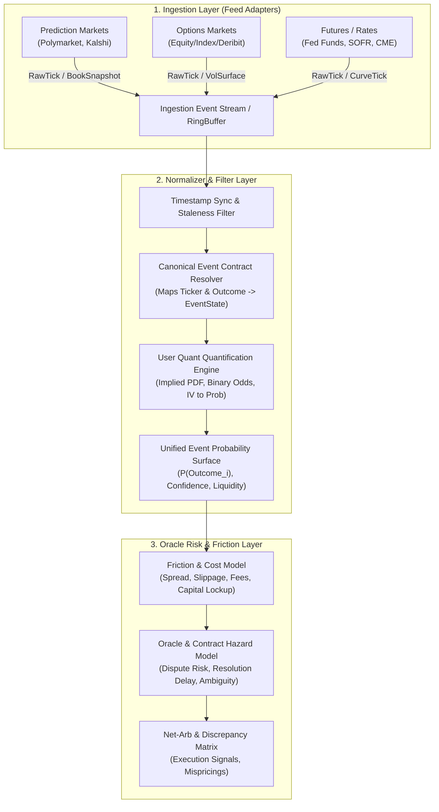

# Cross-Asset Implied Probability Surface: Architectural Framework & Guide

## Goal Description
Build a modular, extensible, high-throughput quantitative framework in Java 21 (Maven) that ingests disparate event-driven market data (prediction markets, equity/index/rates options, and futures), standardizes and aligns them into a unified discrete or continuous implied probability space, and computes net-of-friction risk-adjusted arbitrage and pricing discrepancies across venues (e.g., FOMC, CPI, Tech Earnings).

The system architecture prioritizes:
1. **Clean separation of concerns** across the three requested pillars: **Ingestion**, **Normalizer / Filter**, and **Oracle Risk & Friction**.
2. **Quant Isolation**: Clean interfaces/extension points allowing custom pricing models, probability extraction algorithms (e.g., Breeden-Litzenberger, FedWatch binomial trees, combinatorial state conversions), and risk weighting to be injected without touching ingestion or execution scaffolding.
3. **Low-overhead, Idiomatic Java 21**: Leveraging records, sealed interfaces, pattern matching, and virtual threads (`Thread.ofVirtual()`) with minimal heavy third-party dependencies.

---

## High-Level Architecture Overview



---

## User Review Required

> [!IMPORTANT]
> **Tooling & Auxiliary Languages**: While Java 21 is ideal for ingestion, concurrency, deterministic state normalization, and low-latency pipeline orchestration, certain statistical/optimization tasks (e.g., complex spline fitting or curve calibration) might be easier prototyped in Python or native libraries.
> - **Recommendation**: Keep the core pipeline, data models, and event surface in pure Java 21. If Python is needed for specialized quant research or numerical fitting, provide a gRPC or IPC/shared-memory bridge rather than coupling it tightly to the JVM runtime.

> [!NOTE]
> **Market Quantification Autonomy**: In accordance with your requirements, all actual conversion formulas, PDF extraction (e.g. recovering risk-neutral probabilities from options chains or computing target rate hike probabilities from 30-day Fed Funds futures) are designed as pluggable strategy interfaces (`MarketProbabilityQuantifier<T>`).

---

## Architectural Breakdown

### 1. Ingestion Layer (`com.eventrvcalc.ingestion`)
**Mission**: Connect to heterogeneous sources, handle reconnection and backpressure, and normalize raw external payloads into immutable, strongly typed internal raw ticks.

* **Key Abstractions**:
  - `MarketConnector`: Lifecycle management (`connect()`, `disconnect()`, `subscribe(InstrumentId)`).
  - `FeedType`: Polling REST vs. Streaming WebSocket / SSE.
  - `RawMarketTick`: Java 21 sealed record containing:
    - `venue`: `VenueId` (e.g., `KALSHI`, `POLYMARKET`, `CME`, `INTERACTIVE_BROKERS`)
    - `exchangeTimestamp`: Instant from venue
    - `receiptTimestamp`: Local monotonic instant
    - `bid`, `ask`, `lastPrice`, `size`
    - `metadata`: Venue-specific contract identifiers (e.g., strike, expiry, condition ID)
* **Concurrency Model**:
  - Java 21 Virtual Threads per feed connection (`Executors.newVirtualThreadPerTaskExecutor()`).
  - Lock-free ring buffer or standard Java `ConcurrentLinkedQueue` / JCTools MPSC queue to fan ticks into the normalizer layer without blocking socket I/O.

---

### 2. Normalizer / Filter Layer (`com.eventrvcalc.normalizer`)
**Mission**: Turn raw market-specific ticks into a standardized, canonical event state distribution and screen out market micro-structure noise.

* **Sub-components**:
  1. **Canonical Event Registry (`EventDefinition`)**:
     - Standardized definition of real-world events.
     - Example: `FOMCEvent(Instant decisionDate, Set<BasisPointChange> possibleOutcomes)` or `CPIEvent(YearMonth printMonth, TargetRange releaseRange)`.
     - Maps venue-specific contracts (e.g., Kalshi `FED-25DEC-T4.50`, Polymarket `Fed interest rate decrease in Dec 2024?`, CME Fed Funds Futures ZQZ4) to the exact same canonical state space.
  2. **Filtering & Synchronization Pipeline**:
     - **Staleness Filter**: Drops or flags ticks exceeding `maxStalenessThresholdMs` relative to peers.
     - **Crossed/Illiquid Book Guard**: Rejects or widens bounds on wide bid-ask spreads or inverted order books.
     - **Timestamp Alignment / Clock Skew Handler**: Uses NTP-calibrated offsets or synthetic snapshot epochs.
  3. **Quantification & Surface Interface (`QuantEngine`)**:
     - Pluggable interface:
       ```java
       public interface MarketQuantifier<T extends RawMarketTick> {
           EventProbabilitySlice quantify(T tick, EventDefinition event);
       }
       ```
     - Gives you total ownership to transform:
       - Options chains into risk-neutral distributions (e.g., Breeden-Litzenberger or strike interpolation).
       - Prediction market contract prices into implied probabilities (handling margin/collateral yield effects).
       - Futures prices into discrete rate step probabilities.
  4. **The Probability Surface (`ImpliedProbabilitySurface`)**:
     - Aggregate view at time $t$: For a given `EventDefinition`, a matrix or probability density function $P(X = \omega_i)$ across all reporting venues with error bands and sample volume.

---

### 3. Oracle Risk & Friction Layer (`com.eventrvcalc.risk`)
**Mission**: Determine whether an apparent price or probability discrepancy represents true risk-adjusted arbitrage or merely friction and uncompensated tail risks.

* **Friction Components**:
  - **Direct Transaction Friction**: Taker/maker fees, exchange transaction taxes, gas/settlement network fees (e.g. Polygon for Polymarket vs. CFTC fees for Kalshi).
  - **Market Impact & Bid-Ask Drag**: Realistic execution at depth rather than top-of-book mid.
  - **Capital Cost / Opportunity Cost**: Capital lockup duration until event settlement date (cost of carry / risk-free rate on locked margin).
* **Oracle & Structural Hazards**:
  - **Oracle / Settlement Ambiguity Risk**: Risk that Kalshi, Polymarket, or CME resolve against divergent official benchmark definitions or experience resolution disputes/delays (e.g., UMA oracle disputes).
  - **Counterparty & Custody Haircuts**: Venue-specific haircut factors representing credit/regulatory risk.
  - **Payout Timing Asymmetry**: Venue A paying out $T+0$ hours vs. Venue B paying out $T+48$ hours.
* **Output / Strategy Signals**:
  - `ArbitrageOpportunity` / `DiscrepancySignal`:
    - Gross spread vs. Net spread (after all frictions)
    - Sharpe / Return on Capital (ROC) annualized over event horizon
    - Risk score (oracle divergence penalty)

---

## Recommended Package Structure

```text
com.eventrvcalc
├── core
│   ├── model            // Canonical Events, EventOutcome, Venue, InstrumentId
│   └── surface          // ImpliedProbabilitySurface, ProbabilitySlice, DensityCurve
├── ingestion
│   ├── api              // MarketConnector, RawMarketTick, FeedListener
│   ├── engine           // FeedManager, Dispatcher, ConnectionLifecycles
│   └── venues           // PolymarketConnector, KalshiConnector, CmeConnector, etc.
├── normalizer
│   ├── filter           // StalenessFilter, SpreadFilter, OutlierRejection
│   ├── mapping          // EventContractRegistry (Maps exchange symbols -> EventOutcomes)
│   └── quant            // MarketQuantifier interface & registry (Your quant domain)
├── risk
│   ├── friction         // FeeSchedule, SlippageModel, CapitalLockupCalculator
│   ├── oracle           // SettlementRiskModel, VenueHaircutRegistry
│   └── arb              // SurfaceDiscrepancyEngine, ArbitrageOpportunity
└── Main.java            // Orchestrator / Pipeline Bootstrap
```

---

## Phased Implementation Roadmap

1. **Phase 1: Domain Foundation & Canonical Contracts**
   - Define core Java 21 records (`EventDefinition`, `EventOutcome`, `RawMarketTick`, `ProbabilitySlice`).
   - Define the `MarketQuantifier` interface so quant models can be developed and unit tested in isolation.

2. **Phase 2: Ingestion & Mock Harness**
   - Implement basic connector abstractions.
   - Build a `MockFeedConnector` that replays recorded market snapshots (FOMC/CPI days) to allow offline quant iteration without requiring live credentials.
   - Wire the first live connector (e.g. Kalshi or Polymarket public REST/WS).

3. **Phase 3: Normalizer & Surface Aggregator**
   - Implement the contract mapping registry (e.g. mapping Kalshi Fed rate markets to standard basis point hike buckets).
   - Implement the pipeline that collects slices and constructs the `ImpliedProbabilitySurface`.

4. **Phase 4: Friction & Oracle Hazard Modeling**
   - Build fee and slippage modules.
   - Build the discrepancy scanner that evaluates cross-venue mispricings net of friction.

---

## Verification Plan

### Automated Tests
- **Unit Tests (`src/test/java`)**:
  - Test canonical contract mapping (e.g., verifying symbol mapping produces identical `EventOutcome` keys).
  - Test filtering logic (staleness rejection, inverted book detection).
  - Test risk/friction deduction (ensuring net spread correctly deducts fees, capital drag, and haircut).
- **Run command**:
  ```powershell
  .\mvnw.cmd test
  ```

### Manual Verification
- Replay a historical event dataset (e.g., March 2024 FOMC or June 2024 CPI print) through the mock harness to visually inspect the resulting probability surface and verify that known arbitrage/discrepancies are flagged accurately.
